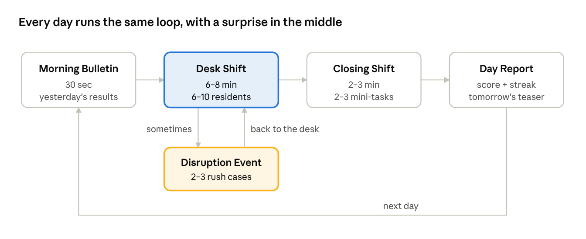
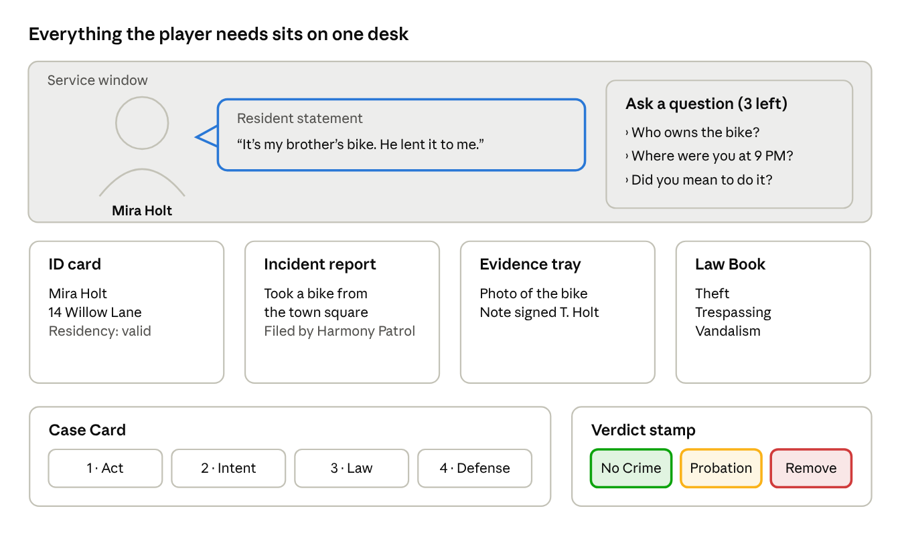
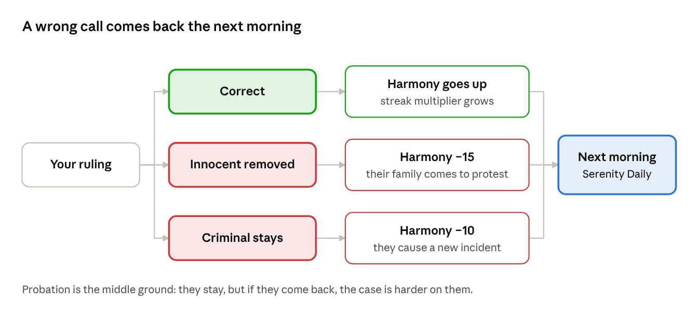

# Single-Player Mode: The Harmony Desk — Gameplay Overview

*Nov 5, 2026 · Senior Project*

## Premise

The player is the **Harmony Facilitator** of Serenity Vale. It's a "perfect" utopia town where nothing is supposed to go wrong, and it's your job to keep it that way. Every day, residents line up at your desk at the Harmony Office. Each one comes with paperwork and an incident report about something that happened in town. You decide whether it was a **crime or no crime**, and whether that person **stays in Serenity Vale or is removed**.

- **Setting:** An alternate-world town with pastel buildings, cheerful announcements, and an always-smiling mayor's voice on the intercom. Underneath, small "Disruptions" keep happening, and the cheerful surface starts to crack as the days go on.

- **Inspiration:** The same desk-and-visitor setup as *That's Not My Neighbor*. People come to a window one at a time, you study their documents and story, and you make the call. Instead of spotting impostors, you spot crimes, and you have to work out the reasoning behind them.

- **Tone:** Cozy on the surface, uneasy underneath. Your mistakes show up in the town, so the job feels like it matters.

- **Learning goal:** Every decision is a short crime/no crime scenario analysis. Was there an act? Was there intent? Which law applies? Is there a defense?

## Core loop: one day

One day takes about 8–12 minutes, which is short enough that "just one more day" is always tempting.

1.  **Morning Bulletin (30 sec).** The *Serenity Daily* newspaper shows what happened because of yesterday's decisions, the day's new law, and a Daily Modifier (for example, "Festival Day: more visitors, more noise complaints").

2.  **Desk Shift (6–8 min).** 6–10 randomized residents come to the window. For each one you review the case and give a verdict (see The Desk).

3.  **Disruption Event (mid-shift, sometimes).** Something goes out of control, like a blackout, a stampede at the market, or a broken water main. Then a rush of 2–3 urgent cases arrives with a shorter timer.

4.  **Closing Shift (2–3 min).** You have to finish 2–3 mini-tasks to close out the day's paperwork (see Mini-tasks). If they're incomplete, you lose points.

5.  **End-of-Day Report.** You see your accuracy, Harmony change, streak, rank progress, and one teaser line about tomorrow ("A resident you approved today was seen near the bakery fire...").

daily loop · 4 phases + a surprise Disruption

The Disruption is the wildcard. It doesn't happen every day, so players never know when the rush will come.

## The Desk: crime or no crime

Each resident is one short case. You read it, investigate it, and rule on it in about 45–90 seconds.

desk screen mockup · example case: Mira Holt

The resident and their statement fill the top half of the screen. The documents sit on the desk below, and the Case Card and verdict stamp come last.

**What shows up on the desk**

| Item               | What it tells you                                      | Where the clues hide                                          |
|--------------------|--------------------------------------------------------|---------------------------------------------------------------|
| Resident ID card   | Name, photo, address, residency status                 | A mismatched photo or expired date can mean a forged ID       |
| Incident report    | What happened, written by the Harmony Patrol           | The core scenario: who did what, when, where                  |
| Resident statement | Their side of the story, in their own words            | Contradictions with the report, excuses, defenses             |
| Evidence tray      | 1–3 items (receipt, photo, witness note, camera still) | Some items help their case, some hurt it, some are irrelevant |
| Law Book           | Every town law you've unlocked so far                  | The legal standard you check the case against                 |

**Investigate.** You get 3 questions per resident, chosen from a short list such as "Where were you at 9 PM?", "Did you mean to do it?", or "Who else was there?" Their answers can reveal intent, an alibi, or a lie. You can only ask 3, so choosing which ones to ask is part of the skill.

**Analyze.** Before the verdict, you fill in a quick 4-step Case Card. This is where the crime/no crime analysis happens:

1.  **Act:** Did they actually do something (or fail to do something they were required to)?

2.  **Intent:** Was it on purpose, reckless, or an accident?

3.  **Law:** Which law in the Law Book does it match, if any?

4.  **Defense:** Does anything excuse it, like self-defense, an emergency, permission, or a mistaken identity?

**Verdict.** You stamp one of three:

- **No Crime: Stay.** The resident goes back to town.

- **Minor Crime: Stay on Probation.** They stay, but they're flagged. If they show up again, the case is harder on them.

- **Serious Crime: Removed from Town.** They're escorted out through the gate.

**Example case.** Resident Mira Holt is reported for "taking a bike from the town square." Her statement says it's her brother's bike and he lent it to her. Evidence: a photo of the bike and a note signed "T. Holt." If you ask "Who owns the bike?" she names her brother, and the ID card shows the same address. **Correct ruling:** No Crime (the defense is permission). If you rule Theft, you remove an innocent resident.

## Mini-tasks: the Closing Shift

Before you can end the day, you have to clear 2–3 timed mini-tasks drawn from that day's cases. Each one takes 30–90 seconds and practices one skill from the crime/no crime analysis.

| Mini-task        | How it plays                                                                                      | Skill it builds                       |
|------------------|---------------------------------------------------------------------------------------------------|---------------------------------------|
| Evidence Sort    | Drag 8–10 items into **Relevant**, **Irrelevant**, or **Tampered** bins before the timer runs out | Judging which evidence matters        |
| Law Match        | Draw lines connecting 4–6 short scenarios to the correct law, including a "No law broken" slot    | Matching facts to legal definitions   |
| Timeline Rebuild | Put 5 event cards in order. If the order doesn't work, the alibi breaks                           | Testing alibis and sequence           |
| Spot the Lie     | Read a short statement next to a report and tap the sentence that contradicts it                  | Finding inconsistencies               |
| Intent Sorter    | Sort quick one-liners into **On Purpose**, **Reckless**, or **Accident**                          | Telling different mental states apart |
| File the Case    | Stamp and file 5 folders into the right drawer (Stay / Probation / Removed) based on summaries    | Fast review of verdicts               |

- **Rewards:** Each completed mini-task earns **Insight Points**. You can spend them the next day on one-time helpers, such as a 4th question, a "highlight a clue" hint, or extra time.

- **Failing:** If you fail a mini-task, the office stays open late. That costs Harmony and makes the next day's timer 10% shorter.

- **Freshness:** Each day draws a different mix, and the content comes from the residents you just processed, so the tasks feel connected to the day's story instead of being random quizzes.

## Consequences

Every wrong call has a consequence the player can see, usually the next morning. That delay keeps a mistake from feeling like an instant game over, and it gives players a reason to come back to find out what happened.

consequence flow · ruling to next morning

Every path, right or wrong, leads to the next morning's newspaper. That's where the player finds out how their calls turned out.

**Three meters**

- **Harmony (town happiness), 0–100.** If it reaches 0, the town falls into chaos and the run ends.

- **Trust (how residents feel about you).** Harsh rulings lower it. When Trust is low, residents lie more often and answer your questions less helpfully.

- **Overseer Record (your job).** Every wrong ruling is a strike. If you get 3 strikes in one day, the Overseer calls you in for a review. That's a short quiz, and if you fail it, you're demoted (you lose a rank and an unlock).

| Mistake                                                | What happens                                                                                                                                      |
|--------------------------------------------------------|---------------------------------------------------------------------------------------------------------------------------------------------------|
| Removed an innocent resident                           | Harmony −15. The next day their family member comes to the desk upset, and the newspaper headline is "Beloved Baker Wrongly Exiled." Trust drops. |
| Let a criminal stay                                    | Harmony −10. The next day they cause a new incident, which brings a harder case and possibly a Disruption. The newspaper names you.               |
| Gave probation to someone who deserved removal         | Harmony −5. There's a 50% chance they come back with a worse offense.                                                                             |
| Picked the wrong law even though the verdict was right | Small score loss and a note in your file. A pattern of this triggers an Overseer review.                                                          |
| Ran out of time on a case                              | The resident is auto-approved (they stay). That can be a hidden mistake.                                                                          |

**Doing it right pays off too.** A correct ruling adds Harmony, builds a streak multiplier (×1.5 after 5 in a row), and sometimes earns a thank-you from a resident that hints at a future case.

## Progression

A full run lasts 15 days, split into 3 weeks. Each week adds one new layer of difficulty. The Law Book grows by about one law per day, so new players are never buried in rules.

| Week                | New laws                                       | What gets harder                                                               | New mechanic                                                            |
|---------------------|------------------------------------------------|--------------------------------------------------------------------------------|-------------------------------------------------------------------------|
| Week 1: Orientation | Trespassing, Theft, Vandalism, Noise, Curfew   | Cases are clear-cut and documents are honest                                   | Case Card is filled in with hints                                       |
| Week 2: Cracks      | Assault, Fraud, Reckless Endangerment, Bribery | Forged IDs, lying statements, defenses (self-defense, emergency)               | Disruption Events start, and probation residents come back              |
| Week 3: Unrest      | Conspiracy, Obstruction, Tampering             | Several people in one case, planted evidence, a resident trying to bribe *you* | Overseer reviews, timers get shorter, and the hidden storyline picks up |

- **Ranks:** Trainee → Clerk → Facilitator → Senior Facilitator → Harmony Chief. Each rank unlocks something: a magnifying glass tool, a 4th question, a UV light for forged documents, or new desk decorations.

- **Facilitator Journal:** Unlocks entries about recurring residents and the history of the town. This is where the lore lives for players who want it.

## Randomization and replayability

Each resident is assembled from parts, so no two runs play the same way.

- **Resident generator:** A random name, a portrait built from mix-and-match features, an address, a personality (nervous, chatty, rude, overly polite), and a Trust reaction.

- **Scenario templates:** About 25 templates with blanks filled in at random, for example "\[Resident\] was seen \[taking/breaking/entering\] \[object/place\] at \[time\]." Each template has a hidden **truth flag** (Crime / No Crime / Minor), and the game generates matching clues and red herrings to fit it.

- **Tells:** Some cases include planted inconsistencies drawn from a pool (wrong date, photo mismatch, a statement that contradicts the timeline). An honest resident can still have one harmless oddity, so a single clue never decides the case on its own.

- **Daily Modifiers:** Festival Day (more cases), Blackout (evidence photos are dark), Rainy Day (fewer witnesses), Mayor's Visit (double Harmony for every ruling, good or bad).

- **Daily Seed:** Everyone gets the same day of cases, so friends or classmates can compare scores.

## Why it's addicting

The hook is the gap between a decision and finding out how it turned out: you rule today, and the newspaper tells you tomorrow whether you were right.

- **Short sessions:** A day is about 10 minutes and ends on a cliffhanger line, which makes "one more day" the default.

- **Delayed reveals:** Whether a ruling was right sometimes isn't revealed until 1–2 days later, so players keep going to find out.

- **Streaks and multipliers:** Correct rulings in a row build a score multiplier, and losing it hurts just enough to make the next case tense.

- **Recurring residents:** People you let stay come back. Recognizing them ("wait, Mira again?") rewards attention and makes the town feel alive.

- **Variety in each day:** Fast desk decisions, a sudden Disruption rush, and then a different kind of challenge in the mini-tasks keep the pace changing.

- **Mystery storyline:** The Disruptions aren't random. A hidden thread across the 15 days hints that someone is causing them on purpose, and clues show up in case details.

- **Mastery you can feel:** By Week 3 the player can break down a case in seconds, and visibly getting better is satisfying.

## Endings

The ending depends on how you ruled over all 15 days, not only on your final score. That gives players a reason to replay.

| Ending             | How you get it                                               | What it says                                                              |
|--------------------|--------------------------------------------------------------|---------------------------------------------------------------------------|
| True Harmony       | Harmony 70+ and accuracy 85%+                                | You were fair, and the town really is a utopia                            |
| Iron Order         | Harmony is fine, but you removed far more people than needed | The town is quiet because it's afraid. Utopia, but at what cost?          |
| Open Gates         | You were lenient and approved almost everyone                | Crime takes over and the town slowly falls apart                          |
| The Collapse       | Harmony hits 0 at any point                                  | Game over. Serenity Vale falls into chaos                                 |
| The Truth (secret) | You found the clues to who is causing the Disruptions        | You expose the cause and see the real reason the town needs a Facilitator |

## Scope notes for the senior project

A playable first version needs about 5 days, 8 laws, 15 scenario templates, and 3 mini-tasks. Everything after that is extra content.

- **Minimum version:** Week 1 only, with the Desk, Case Card, Evidence Sort, Law Match, Spot the Lie, the Harmony meter, and the morning newspaper.

- **Data-driven:** Store laws, scenario templates, and evidence pools in JSON or spreadsheet files. Then teammates can write new cases without touching code.

- **Accuracy matters:** The crime/no crime answer for each template should be checked against the laws you define, so the game teaches the reasoning correctly. A teacher or an advisor with a legal background is a good reviewer.

- **Stretch goals:** Weeks 2–3, the secret ending, the Daily Seed leaderboard, and voice lines for residents.
