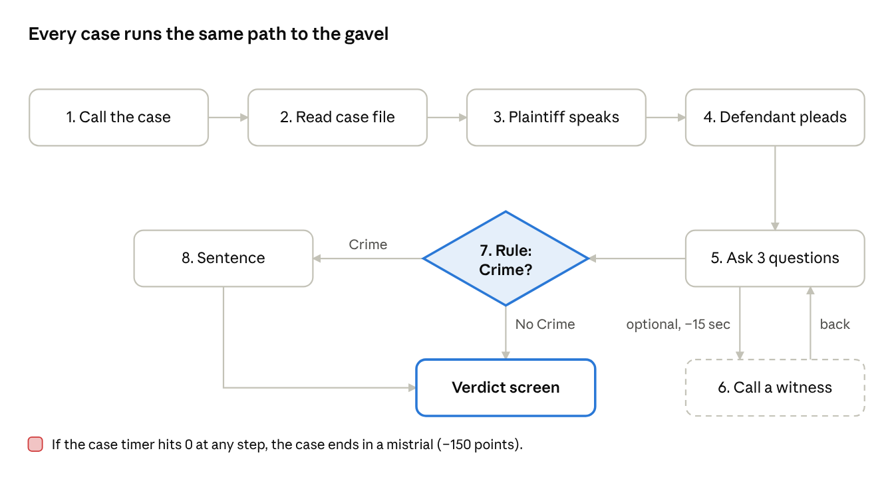
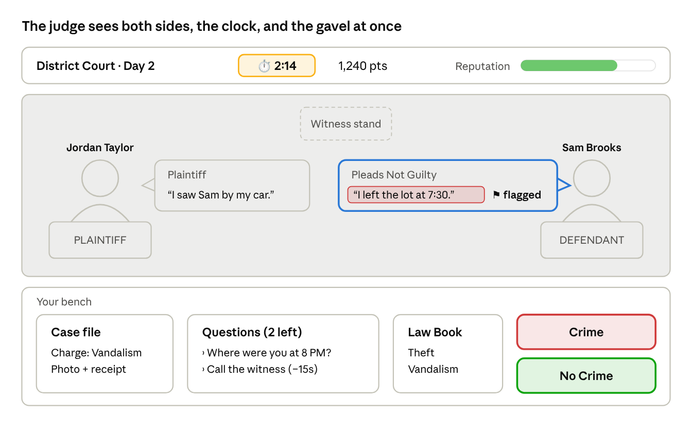
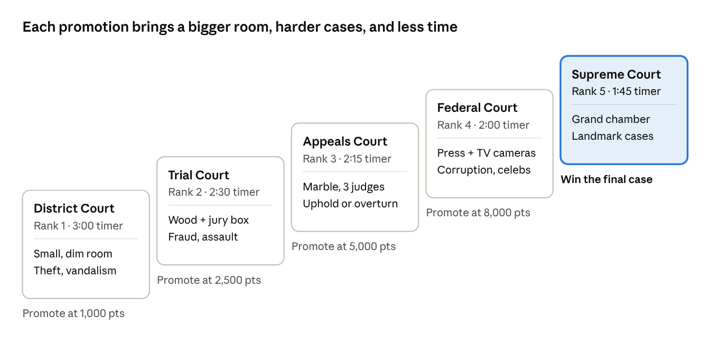

# Order in the Court — Single-Player Gameplay Overview

*Nov 5, 2026 · Senior Project*

## The game in one minute

You're a newly appointed judge, and your goal is to climb from a small District Court all the way to the Supreme Court. You do that one case at a time, by deciding **crime or no crime** before the timer runs out.

- **Who you are:** Judge \[player name\], sworn in on day one in a run-down district courtroom.

- **What you do:** Randomized people come before your bench. A plaintiff (the person accusing) and a defendant (the person accused) argue their sides, the way they do on *Judge Judy*. You hear them out, question them, call witnesses, check evidence, and rule.

- **How you win:** Correct rulings earn points. Points get you promoted. Each promotion brings a bigger courtroom, harder cases, and bigger scandals.

- **How you lose:** Wrong rulings, running out of time, or getting caught in a scandal will hurt your Reputation. If it reaches zero, you're removed from the bench.

- **Inspirations:** *Papers, Please*, *That's Not My Neighbor*, *Shift at Midnight*, and *No, I'm Not a Human*. Like those games, you sit at one desk, people come to you one at a time, you look for clues and lies, you're working against a clock, and every choice has a consequence.

## What the player does in one case, step by step

Every case follows the same 8 steps. A case takes 2–4 minutes, and a work day (one level) has 5–8 cases.

1.  **Call the case.** Tap the gavel. The bailiff announces the case name, like *“Taylor v. Brooks: a damaged car.”* The case timer starts.

2.  **Read the case file.** A folder slides onto your bench with the charge, the law that might apply, and 1–3 pieces of evidence. Tap any item to zoom in.

3.  **Hear the plaintiff.** The accuser walks to their podium and tells their side in 2–4 short speech bubbles.

4.  **Hear the defendant's plea.** The defendant chooses **Not Guilty** (and gives their story) or **Guilty** (and asks for mercy). A guilty plea can still be a lie, for example when someone is covering for a friend.

5.  **Question them.** You have 3 question cards per case, such as “Where were you at 8 PM?”, “Can you prove that?”, or “Why didn't you report it?” Each answer can reveal a clue or a contradiction. When you catch a lie, tap the sentence to **flag** it.

6.  **Call a witness (optional).** Some cases have 1–2 witnesses waiting. Calling one costs 15 seconds of the timer. A witness might help, might hurt, or might be lying too.

7.  **Rule: Crime or No Crime.** Bang the gavel and pick one. If it's a crime, also pick which law was broken from your Law Book.

8.  **Sentence (if guilty).** Choose a consequence that fits: a warning, a fine, community service, probation, or jail. A sentence that's far too harsh or too light loses points.

After the gavel, the **Verdict Screen** shows whether you were right, your points, and a short newspaper headline. Then the next case is called.

one case · 8 steps, 1 decision

The ruling is the one big decision. Everything before it is gathering clues against the clock.

## Example case played out

**Taylor v. Brooks**, District Court, Level 1, with a 3:00 timer.

| Step       | What happens on screen                                                                                                                       | What the player is thinking                                                              |
|------------|----------------------------------------------------------------------------------------------------------------------------------------------|------------------------------------------------------------------------------------------|
| Case file  | Charge: Vandalism (damaging someone's property on purpose). Evidence: a photo of a keyed car door and a parking lot receipt stamped 7:42 PM. | “So it has to be *on purpose*, and the receipt gives me a time.”                         |
| Plaintiff  | Jordan Taylor: “I saw Sam Brooks walking away from my car right after. Sam's been mad at me since I got the promotion.”                      | “That's a motive, but did Jordan actually *see* Sam do it?”                              |
| Plea       | Sam Brooks pleads **Not Guilty**: “I was parked next to Jordan. I left at 7:30 and never touched the car.”                                   | “The receipt says 7:42. Is that Sam's receipt?”                                          |
| Question 1 | “Can you prove when you left?” Sam: “My receipt is in the file.”                                                                             | The receipt in the file says **7:42**, not 7:30, so the player flags the lie.            |
| Question 2 | Jordan is asked “Did you see the scratch happen?” Jordan: “Well, no. I saw Sam near it.”                                                     | Jordan's story is weaker than it sounded.                                                |
| Witness    | A security guard says they saw someone in a red jacket drag something along the car at about 7:40. Sam is wearing a red jacket.              | The time and the jacket match Sam.                                                       |
| Ruling     | The player picks **Crime → Vandalism**.                                                                                                      | The act, the intent (the motive plus a lie about the time), and a witness are all there. |
| Sentence   | The player picks **Fine + pay for the repair**.                                                                                              | That's a fair sentence for a first offense. Jail would count as too harsh.               |

**Result:** Correct verdict, correct law, fair sentence, 1 lie caught, and time left on the clock. That's +260 points (see Timer and points). Headline: *“Rookie Judge Cracks Parking Lot Case.”*

**Twist version:** Another time this case comes up, the receipt might say 7:25 and the guard might describe a *blue* jacket. Then the correct ruling is **No Crime**, because Sam was wrongly accused. The same case template can have different true answers each time it's played.

## The courtroom screen

You sit at the judge's bench and look down at the courtroom. The two sides stand at the podiums, and your tools sit on the bench in front of you.

courtroom screen mockup · Taylor v. Brooks

- **Top bar:** your rank and day, the case timer, your points, and your Reputation meter.

- **Courtroom:** the plaintiff on the left, the defendant on the right, and a witness stand in the middle. Speech bubbles appear above whoever is talking, and you tap a sentence to flag it as a lie.

- **Your bench:** the case file, your question cards, the Law Book, and the two gavel buttons.

## Timer and points

Every case has its own countdown, and **Points** decide when you get promoted. There's also a separate **Reputation** meter that decides whether you keep your job.

**The timer**

- Each case starts with a set amount of time. It's 3:00 at District Court and gets shorter as you rank up (see Ranks).

- Calling a witness costs 15 seconds. Zooming in on evidence and reading the Law Book are free, but the clock keeps running while you do.

- In the last 30 seconds, the clock turns red, the music speeds up, and the people in the courtroom start murmuring.

- If time runs out, the case ends in a **mistrial**: −150 points and −10 Reputation.

**Points for each case**

| What you did                             | Points               |
|------------------------------------------|----------------------|
| Correct verdict (Crime / No Crime)       | +100                 |
| Picked the correct law                   | +50                  |
| Fair sentence                            | +50                  |
| Each lie you correctly flagged           | +30                  |
| Time bonus (for every 30 sec left)       | +10                  |
| Streak bonus (3+ correct cases in a row) | +25 per case         |
| Wrong verdict                            | −100, Reputation −15 |
| Wrong law                                | −25                  |
| Sentence far too harsh or too light      | −25                  |
| Flagged something that wasn't a lie      | −10                  |
| Mistrial (time ran out)                  | −150, Reputation −10 |

In the Taylor v. Brooks example, that adds up to 100 + 50 + 50 + 30 + 30 (90 sec left) = **260 points**.

**Two meters on screen at all times**

- **Points:** These go up and down with every case. Reaching the target for your level unlocks the **Promotion Hearing**.

- **Reputation (0–100):** This is how much the public and the bar association trust you. If it reaches 0, you're removed from the bench (see Consequences). Scandals hit this meter the hardest.

## Mini-game: Complete the Law

You fill in the missing words of a law before the timer runs out. Every law you complete is added to your **Law Book**, and you need those laws to rule on future cases.

**When it shows up**

- **Recess (between cases):** One quick round per work day (30–45 sec). It teaches a law you'll need later that same day.

- **Promotion Hearing (end of each rank):** 3 rounds in a row. You have to pass to move up (see Ranks).

**How it plays, step by step**

1.  A law appears with 2–4 blanks. Example: *“A person commits **Theft** when they \_\_\_\_ property that belongs to \_\_\_\_ with the intent to \_\_\_\_ the owner of it.”*

2.  A word bank appears underneath with the right words mixed in with decoys: take, borrow, another person, the city, permanently deprive, briefly show.

3.  Drag each word into a blank. Correct blanks lock in green, and wrong ones shake red and cost 3 seconds.

4.  When every blank is correct, the law is stamped **ENACTED** and added to your Law Book.

**Scoring:** +20 per correct blank, +50 for a perfect round, and a time bonus. If you fail a Promotion Hearing round, you can retry after your next work day.

**It gets harder as you rank up:** more blanks, decoys that look almost right (reckless vs. intentional), and at the Supreme Court, no word bank at all. There you have to type the missing word.

## Ranks: District Court to Supreme Court

There are 5 ranks. Each rank lasts 3–5 work days. When you hit the point target, you take the Promotion Hearing (a Complete the Law exam). If you pass, you move up.

rank ladder · 5 ranks, District Court to Supreme Court

| Rank                       | Courtroom upgrade                                                                       | New scenarios added                                                                                                                       | Case timer | Promote at |
|----------------------------|-----------------------------------------------------------------------------------------|-------------------------------------------------------------------------------------------------------------------------------------------|------------|------------|
| 1\. District Court Judge   | Small, dim room, a flickering light, folding chairs, a squeaky gavel                    | Petty theft, vandalism, noise complaints, neighbor feuds, small claims. Everyone tells the truth or tells one obvious lie                 | 3:00       | 1,000 pts  |
| 2\. Trial Court Judge      | Wood paneling, a jury box, a court reporter, a real flag                                | Fraud, assault, DUI, self-defense claims, forged evidence, 2 witnesses per case                                                           | 2:30       | 2,500 pts  |
| 3\. Court of Appeals Judge | Marble walls, raised bench, 3 judge seats (you plus 2 AI judges who sometimes disagree) | **Appeals:** you review another judge's past ruling and decide to **Uphold** or **Overturn** it. Hidden mistakes are in the old case file | 2:15       | 5,000 pts  |
| 4\. Federal Judge          | Federal seal, a press gallery, TV cameras, protesters outside the window                | Corruption, celebrity defendants, cybercrime, several defendants in one case, witnesses who flip their story                              | 2:00       | 8,000 pts  |
| 5\. Supreme Court Justice  | A grand marble chamber, 9 seats, a packed public gallery                                | Landmark cases where the law itself is unclear, plus one final case that ties together the scandals from your whole career                | 1:45       | Final case |

**You can see the upgrades happen.** After each promotion, there's a short scene of you walking into the new courtroom for the first time. Your nameplate, robe, and gavel also improve with each rank.

## Randomized people

Every case is assembled from random parts, so no two playthroughs are the same. Each case has 2–4 people.

| Role                   | What they do                                                        | What gets randomized                                                                  |
|------------------------|---------------------------------------------------------------------|---------------------------------------------------------------------------------------|
| Plaintiff              | Accuses the defendant and explains what happened                    | Look, name, personality (calm, dramatic, rude, nervous), whether they're exaggerating |
| Defendant              | Pleads Guilty or Not Guilty and tells their side                    | Look, name, personality, plea, whether they're lying, how they react to questions     |
| Witness (0–2)          | Answers one question about what they saw                            | Who they are (neighbor, guard, coworker), whether they're honest, biased, or bribed   |
| Bailiff (always there) | Calls cases and keeps order. Gives one free hint per day if you ask | Nothing. The bailiff is a friendly recurring character                                |

**How the randomizing works**

1.  The game picks a **case template** for your rank, for example “damaged property” or “missing money.”

2.  It secretly decides the **truth**: Crime or No Crime, and which law applies.

3.  It generates evidence, statements, and witnesses that fit the truth, plus 1–2 **red herrings** (clues that look important but aren't).

4.  It plants **tells** for any liars, like a time that doesn't match the receipt, a story that changes between answers, or a witness who knows something they couldn't have seen.

**Like *That's Not My Neighbor*, look closely.** Small details matter. A defendant's shoes might match the muddy footprint photo, or a witness might be wearing the same company badge as the plaintiff (which makes them biased).

**Repeat offenders:** If you let a guilty person go, they can come back later in a bigger case. Your past rulings follow you.

## Scandals

The higher you climb, the more people try to get to you. Scandals tempt you with shortcuts, and each one you accept fills a hidden **Exposure** meter. If it fills up, the press breaks the story.

**How a scandal plays out, step by step**

1.  **The offer arrives** between cases: an envelope slid under your bench, a late-night phone call, or a text from an unknown number.

2.  **You read it.** Example: *“Rule Not Guilty for Mr. Vance tomorrow and there's \$10,000 in it for you.”*

3.  **You choose:**

    - **Accept:** +300 points right away, but Exposure goes up. You also have to rule the way you were paid to, even if it's wrong.

    - **Refuse:** +5 Reputation. Nothing else happens.

    - **Report it:** +15 Reputation. The person who offered becomes an enemy and shows up later in a bigger case.

4.  **The press reacts.** Each morning, *The Daily Gavel* tabloid shows headlines about you. Ignored scandals come back as rumors.

**Scandals get bigger as you rank up**

| Rank          | Type of scandal                                                              |
|---------------|------------------------------------------------------------------------------|
| District      | A gift basket from a defendant's family, a favor from the mayor's cousin     |
| Trial Court   | Cash bribes, a lawyer who is your old friend                                 |
| Appeals       | Leaked case files, pressure from another judge                               |
| Federal       | Celebrity favors, a politician's blackmail, reporters digging into your past |
| Supreme Court | The final case is connected to every scandal you accepted or reported        |

**Framed!** Sometimes an enemy plants fake evidence against *you*. Then the courtroom flips. You stand at the defendant's podium in a **Scandal Hearing**, and you have to point out the forged evidence before the timer runs out. If you lose, you take a big Reputation hit.

## Consequences, game over, and endings

Mistakes cost points, Reputation, and sometimes a person's freedom. The game shows you who your ruling affected.

- **Wrong “Crime” ruling:** An innocent person is sentenced. The next morning's paper runs their story, and they may appeal later. If you face that appeal at the Appeals rank, you're reviewing your own mistake.

- **Wrong “No Crime” ruling:** A guilty person walks free and can come back with a bigger crime.

- **Bad day:** If you have 3 wrong verdicts in one day, you get a **Judicial Review**. That's a short warning cutscene, and the next day's point target goes up.

- **Demotion:** If Reputation drops below 25, you're sent back down one rank.

- **Game over:** If Reputation reaches 0 or the Exposure meter fills up, you're **removed from the bench**. You see a final newspaper front page about your career.

**Endings (after the final Supreme Court case)**

| Ending               | How you get it                                                                 |
|----------------------|--------------------------------------------------------------------------------|
| The People's Justice | High accuracy, no scandals accepted                                            |
| The Iron Gavel       | High accuracy, but harsh sentences across your career                          |
| Bought and Paid For  | You reached the top by accepting scandals and were never caught                |
| Whistleblower        | You reported every scandal and exposed the enemy behind them in the final case |
| Removed              | Reputation reached 0 or the Exposure meter filled up                           |

## Why it's addicting

Short cases, a clear goal (the next rank), and choices that come back to haunt you make it hard to stop after just one more case.

- **Short, tense rounds:** Each case is 2–4 minutes against a clock, so there's always time for one more.

- **The “gotcha” moment:** Catching a lie (tapping the sentence that doesn't match the receipt) feels great, just like spotting the fake neighbor.

- **Visible progress:** Your courtroom literally gets bigger and fancier. You can see how far you've climbed.

- **Temptation:** Scandals offer easy points right now and risk later. Players will want to see whether they get away with it.

- **Your past comes back:** Repeat offenders, appeals of your own rulings, and enemies you made make the story feel personal.

- **Replay value:** Random people, multiple endings, and true answers that change mean every run is different.

## What to build first

Start with a small version that's fully playable: Rank 1 only, 3 work days, and 10 case templates. Add the other ranks after that works.

- [ ] Courtroom screen with the plaintiff and defendant, speech bubbles, the case file, and the gavel

- [ ] Case timer, question cards, flagging lies, and Crime / No Crime ruling with law pick

- [ ] Points table and Reputation meter

- [ ] 10 District Court case templates, each with a randomized truth

- [ ] Complete the Law mini-game with 5 laws

- [ ] Morning newspaper screen

- [ ] One scandal offer (accept / refuse / report)

- [ ] Then add: Trial Court rank, witnesses, Promotion Hearing

Store cases, laws, and scandals in simple data files (JSON or a spreadsheet). That way, everyone on the team can write new cases without touching the code. Also have someone check each case's correct answer against the law it uses, so the game teaches it correctly.
